<!-- Generated by tools/readme (`npm run readme`) from the portfolio content. Edit the content, not this file. -->

<a href="https://pho0m.kiattiphoom.workers.dev/#top"><picture><source media="(prefers-color-scheme: dark)" srcset="assets/readme/hero-dark.svg"></picture></a>

  <a href="https://pho0m.kiattiphoom.workers.dev"><picture><source media="(prefers-color-scheme: dark)" srcset="assets/readme/btn-portfolio-dark.svg"></picture></a>
  <a href="https://github.com/pho0m"><picture><source media="(prefers-color-scheme: dark)" srcset="assets/readme/btn-github-dark.svg"></picture></a>
  <a href="https://www.facebook.com/Pho0m/"><picture><source media="(prefers-color-scheme: dark)" srcset="assets/readme/btn-facebook-dark.svg"></picture></a>
  <a href="https://www.instagram.com/pho0m/"><picture><source media="(prefers-color-scheme: dark)" srcset="assets/readme/btn-instagram-dark.svg"></picture></a>
  <a href="https://utotech.co.th/"><picture><source media="(prefers-color-scheme: dark)" srcset="assets/readme/btn-utotech-dark.svg"></picture></a>

<a href="https://pho0m.kiattiphoom.workers.dev/#film">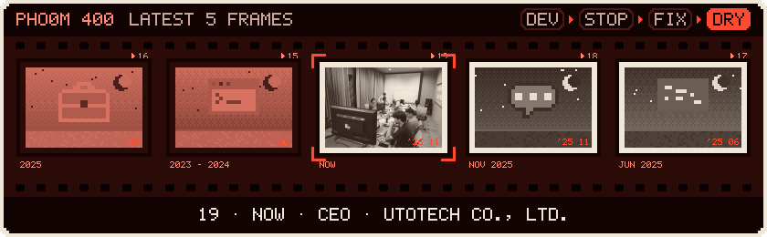</a>

<a href="https://pho0m.kiattiphoom.workers.dev/#film"><picture><source media="(prefers-color-scheme: dark)" srcset="assets/readme/band-film-dark.svg">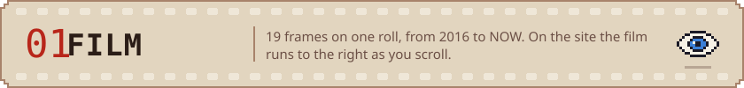</picture></a>

<a href="https://pho0m.kiattiphoom.workers.dev/#film"><picture><source media="(prefers-color-scheme: dark)" srcset="assets/readme/film-latest-dark.svg"></picture></a>

<a href="https://pho0m.kiattiphoom.workers.dev/#skills"><picture><source media="(prefers-color-scheme: dark)" srcset="assets/readme/band-skills-dark.svg">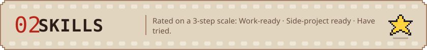</picture></a>

<picture><source media="(prefers-color-scheme: dark)" srcset="assets/readme/skills-expert-dark.svg">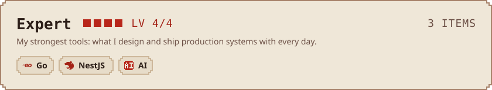</picture>

<picture><source media="(prefers-color-scheme: dark)" srcset="assets/readme/skills-work-ready-dark.svg">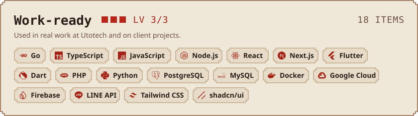</picture>

<picture><source media="(prefers-color-scheme: dark)" srcset="assets/readme/skills-side-project-dark.svg">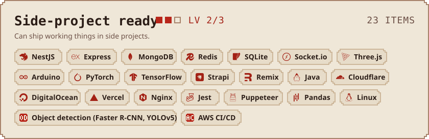</picture>

<picture><source media="(prefers-color-scheme: dark)" srcset="assets/readme/skills-tools-dark.svg">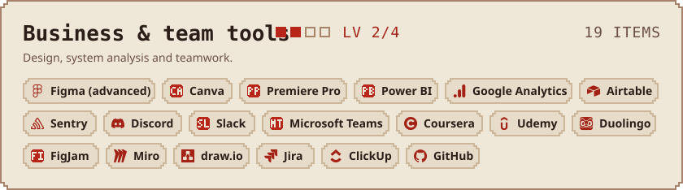</picture>

<picture><source media="(prefers-color-scheme: dark)" srcset="assets/readme/skills-have-tried-dark.svg">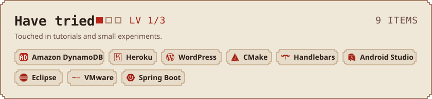</picture>

  <a href="https://pho0m.kiattiphoom.workers.dev/#diary"><picture><source media="(prefers-color-scheme: dark)" srcset="assets/readme/panel-diary-dark.svg">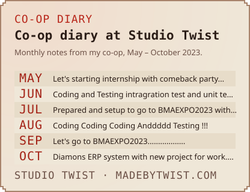</picture></a><a href="https://pho0m.kiattiphoom.workers.dev/#documents"><picture><source media="(prefers-color-scheme: dark)" srcset="assets/readme/panel-docs-dark.svg">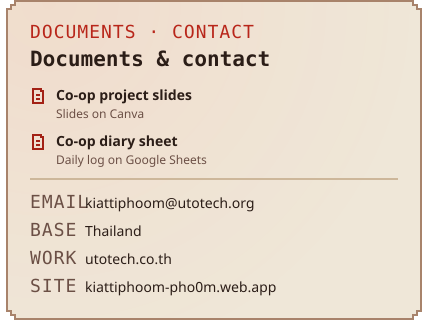</picture></a>

  <a href="mailto:kiattiphoom@utotech.org"><picture><source media="(prefers-color-scheme: dark)" srcset="assets/readme/link-email-dark.svg"></picture></a>
  <a href="https://pho0m.kiattiphoom.workers.dev"><picture><source media="(prefers-color-scheme: dark)" srcset="assets/readme/link-site-dark.svg"></picture></a>
  <a href="https://utotech.co.th/"><picture><source media="(prefers-color-scheme: dark)" srcset="assets/readme/link-company-dark.svg"></picture></a>

