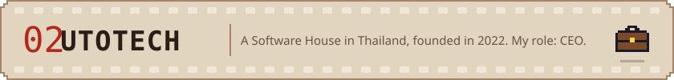
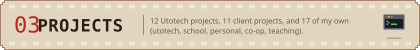

<!-- Generated by tools/readme (`npm run readme`) from the portfolio content. Edit the content, not this file. The WakaTime block is kept as is. -->

<a href="https://kiattiphoom-pho0m.web.app/#top"><picture><source media="(prefers-color-scheme: dark)" srcset="assets/readme/hero-dark.svg"></picture></a>

<p>
  <a href="https://kiattiphoom-pho0m.web.app"><picture><source media="(prefers-color-scheme: dark)" srcset="assets/readme/btn-portfolio-dark.svg"></picture></a>
  <a href="https://github.com/pho0m"><picture><source media="(prefers-color-scheme: dark)" srcset="assets/readme/btn-github-dark.svg"></picture></a>
  <a href="https://www.facebook.com/Pho0m/"><picture><source media="(prefers-color-scheme: dark)" srcset="assets/readme/btn-facebook-dark.svg"></picture></a>
  <a href="https://www.instagram.com/pho0m/"><picture><source media="(prefers-color-scheme: dark)" srcset="assets/readme/btn-instagram-dark.svg"></picture></a>
  <a href="https://utotech.co.th/"><picture><source media="(prefers-color-scheme: dark)" srcset="assets/readme/btn-utotech-dark.svg"></picture></a>
</p>

<a href="https://kiattiphoom-pho0m.web.app/#film"><picture><source media="(prefers-color-scheme: dark)" srcset="assets/readme/band-film-dark.svg"></picture></a>

<a href="https://kiattiphoom-pho0m.web.app/#film"><picture><source media="(prefers-color-scheme: dark)" srcset="assets/readme/film-latest-dark.svg"></picture></a>

<a href="https://kiattiphoom-pho0m.web.app/#utotech"><picture><source media="(prefers-color-scheme: dark)" srcset="assets/readme/band-utotech-dark.svg"></picture></a>

<a href="https://utotech.co.th/"><picture><source media="(prefers-color-scheme: dark)" srcset="assets/readme/utotech-dark.svg"></picture></a>

<a href="https://kiattiphoom-pho0m.web.app/#projects"><picture><source media="(prefers-color-scheme: dark)" srcset="assets/readme/band-projects-dark.svg"></picture></a>

**Client work at Utotech**

| Project | About |
| :-- | :-- |
| **[ISTEd](https://isted.onec.go.th/)** | <picture><source media="(prefers-color-scheme: dark)" srcset="assets/readme/badge-utotech-isted-dark.svg"></picture><br>Information System for Thailand education |
| **[Comedu Reunion](https://kiattiphoom-pho0m.web.app/#utotech)** | <picture><source media="(prefers-color-scheme: dark)" srcset="assets/readme/badge-utotech-comedu-reunion-dark.svg"></picture><br>Booking system and events management |
| **[CGas E-Commerce](https://kiattiphoom-pho0m.web.app/#utotech)** | <picture><source media="(prefers-color-scheme: dark)" srcset="assets/readme/badge-utotech-cgas-e-commerce-dark.svg"></picture><br>Ecommerce and stock management system |
| **[Asia Pacific](https://sb22asiapacific.com/)** | <picture><source media="(prefers-color-scheme: dark)" srcset="assets/readme/badge-utotech-asia-pacific-dark.svg"></picture><br>Conference blog web |
| **[Calcount](https://kiattiphoom-pho0m.web.app/#utotech)** | <picture><source media="(prefers-color-scheme: dark)" srcset="assets/readme/badge-utotech-calcount-dark.svg"></picture><br>Applications for medicine |
| **[Wedding Landing Page](https://kiattiphoom-pho0m.web.app/#utotech)** | <picture><source media="(prefers-color-scheme: dark)" srcset="assets/readme/badge-utotech-wedding-landing-page-dark.svg"></picture><br>A Landing page for replace wedding card |
| **[Titan Automative Drive](https://kiattiphoom-pho0m.web.app/#utotech)** | <picture><source media="(prefers-color-scheme: dark)" srcset="assets/readme/badge-utotech-titan-automative-drive-dark.svg"></picture><br>Applications for control car with moblie |
| **[Covid Alert](https://kiattiphoom-pho0m.web.app/#utotech)** | <picture><source media="(prefers-color-scheme: dark)" srcset="assets/readme/badge-utotech-covid-alert-dark.svg"></picture><br>Tracking covid status at location and statistics |
| **[Keeta Thai Traditional Karaoke](https://vtca-app.web.app/)** | <picture><source media="(prefers-color-scheme: dark)" srcset="assets/readme/badge-utotech-keeta-thai-traditional-karaoke-dark.svg"></picture><br>An application for learning the principles of Thai singing, including the history, lyrics, and more |
| **[Line Official Account Integration (Line OA)](https://kiattiphoom-pho0m.web.app/#utotech)** | <picture><source media="(prefers-color-scheme: dark)" srcset="assets/readme/badge-utotech-line-official-account-integration-line-oa-dark.svg"></picture><br>Custom line oa for your requirement |
| **[Low Code Platform](https://kiattiphoom-pho0m.web.app/#utotech)** | <picture><source media="(prefers-color-scheme: dark)" srcset="assets/readme/badge-utotech-low-code-platform-dark.svg"></picture><br>Custom and make quickly low cost with low code platform |
| **[3d Integrations](https://pho0m.github.io/the-timmy-story/)** | <picture><source media="(prefers-color-scheme: dark)" srcset="assets/readme/badge-utotech-3d-integrations-dark.svg"></picture><br>Integraion with 3d element |

**My own projects**

| Project | About |
| :-- | :-- |
| **[Utotech developer test](https://github.com/pho0m/Utotech-test-solution-developer)** | <picture><source media="(prefers-color-scheme: dark)" srcset="assets/readme/badge-project-utotech-hiring-test-dark.svg"></picture><br>Hiring test for new developers: import, clean and export spreadsheet data with Next.js, TypeScript, Tailwind CSS and shadcn/ui. · Next.js, TypeScript, Tailwind CSS |
| **[SEYES](https://github.com/pho0m/seyes-app)** | <picture><source media="(prefers-color-scheme: dark)" srcset="assets/readme/badge-project-seyes-dark.svg"></picture><br>Classroom usage detection with object-detection AI, split into a Go core web server, a Python detection service, a TypeScript app and a camera server. · Go, Python, TypeScript, AI |
| **[LINE Playground](https://github.com/pho0m/Line-Playground)** | <picture><source media="(prefers-color-scheme: dark)" srcset="assets/readme/badge-project-line-playground-dark.svg"></picture><br>APIs and LIFF apps for a LINE playground running on Firebase. · LINE API, Firebase, JavaScript |
| **[Thap](https://github.com/pho0m/thap)** | <picture><source media="(prefers-color-scheme: dark)" srcset="assets/readme/badge-project-thap-dark.svg"></picture><br>Thai traditional application built with Flutter 2.5. · Flutter, Dart |
| **[The Timmy Story](https://github.com/pho0m/the-timmy-story)** | <picture><source media="(prefers-color-scheme: dark)" srcset="assets/readme/badge-project-the-timmy-story-dark.svg"></picture><br>A 3D web story built with JavaScript. · JavaScript, Three.js · [demo](https://pho0m.github.io/the-timmy-story/) |
| **[pho0m profile](https://github.com/pho0m/pho0m)** | <picture><source media="(prefers-color-scheme: dark)" srcset="assets/readme/badge-project-pho0m-profile-dark.svg"></picture><br>This portfolio, its admin and the GitHub profile README. · React, TypeScript, GCP |
| **[LINE API course](https://github.com/pho0m/line-api-course)** | <picture><source media="(prefers-color-scheme: dark)" srcset="assets/readme/badge-project-line-api-course-dark.svg"></picture><br>Course material for a LINE API workshop at PSC on 6 November. · LINE API, HTML |
| **[Pure PHP template](https://github.com/pho0m/pure-php-template)** | <picture><source media="(prefers-color-scheme: dark)" srcset="assets/readme/badge-project-pure-php-template-dark.svg"></picture><br>PHP template without a framework, made for teaching junior developers. · PHP |
| **[Flutter clean architecture template](https://github.com/pho0m/flutter-template)** | <picture><source media="(prefers-color-scheme: dark)" srcset="assets/readme/badge-project-flutter-template-dark.svg"></picture><br>Starter template for Flutter apps using clean architecture. · Flutter, Dart |
| **[Kru Taew e-learning](https://github.com/pho0m/kru-taew-project)** | <picture><source media="(prefers-color-scheme: dark)" srcset="assets/readme/badge-project-kru-taew-dark.svg"></picture><br>E-learning website template written in HTML. · HTML |
| **[Bangkok History](https://github.com/pho0m/bangkok-history)** | <picture><source media="(prefers-color-scheme: dark)" srcset="assets/readme/badge-project-bangkok-history-dark.svg"></picture><br>Midterm project for a web technology class. · HTML, CSS |
| **[Kiat-Tune](https://github.com/pho0m/kiat-tune-app)** | <picture><source media="(prefers-color-scheme: dark)" srcset="assets/readme/badge-project-kiat-tune-dark.svg"></picture><br>iTunes-style app for a TCT class homework, using the iTunes Store API. · JavaScript, API |
| **[Commu App](https://github.com/pho0m/commu-app)** | <picture><source media="(prefers-color-scheme: dark)" srcset="assets/readme/badge-project-commu-app-dark.svg"></picture><br>Web application for a community. · JavaScript |
| **[Tweed Play](https://github.com/pho0m/tweed-play)** | <picture><source media="(prefers-color-scheme: dark)" srcset="assets/readme/badge-project-tweed-play-dark.svg"></picture><br>Discord music bot template. · Node.js, Discord |
| **[Musiver](https://github.com/pho0m/Musiver)** | <picture><source media="(prefers-color-scheme: dark)" srcset="assets/readme/badge-project-musiver-dark.svg"></picture><br>Music player written in Java. · Java |

<a href="https://kiattiphoom-pho0m.web.app/#skills"><picture><source media="(prefers-color-scheme: dark)" srcset="assets/readme/band-skills-dark.svg"></picture></a>

<picture><source media="(prefers-color-scheme: dark)" srcset="assets/readme/skills-work-ready-dark.svg"></picture>

<picture><source media="(prefers-color-scheme: dark)" srcset="assets/readme/skills-side-project-dark.svg"></picture>

<picture><source media="(prefers-color-scheme: dark)" srcset="assets/readme/skills-tools-dark.svg"></picture>

<picture><source media="(prefers-color-scheme: dark)" srcset="assets/readme/skills-have-tried-dark.svg"></picture>

<p>
  <a href="https://kiattiphoom-pho0m.web.app/#diary"><picture><source media="(prefers-color-scheme: dark)" srcset="assets/readme/panel-diary-dark.svg"></picture></a>
  <a href="https://kiattiphoom-pho0m.web.app/#documents"><picture><source media="(prefers-color-scheme: dark)" srcset="assets/readme/panel-docs-dark.svg"></picture></a>
</p>

<details>
<summary>Current languages (WakaTime)</summary>

<!--START_SECTION:waka-->

```txt
Markdown     6 hrs 9 mins          ████████████░░░░░░░░░░░░░   47.57 %
TypeScript   1 hr 26 mins          ██▓░░░░░░░░░░░░░░░░░░░░░░   11.19 %
Text         1 hr 22 mins          ██▓░░░░░░░░░░░░░░░░░░░░░░   10.60 %
Bash         1 hr 4 mins           ██░░░░░░░░░░░░░░░░░░░░░░░   08.30 %
Python       51 mins               █▓░░░░░░░░░░░░░░░░░░░░░░░   06.68 %
```

<!--END_SECTION:waka-->

</details>

<picture><source media="(prefers-color-scheme: dark)" srcset="assets/readme/roll-end-dark.svg"></picture>

<p>
  <a href="mailto:kiattiphoom@utotech.org"><picture><source media="(prefers-color-scheme: dark)" srcset="assets/readme/link-email-dark.svg"></picture></a>
  <a href="https://kiattiphoom-pho0m.web.app"><picture><source media="(prefers-color-scheme: dark)" srcset="assets/readme/link-site-dark.svg"></picture></a>
  <a href="https://utotech.co.th/"><picture><source media="(prefers-color-scheme: dark)" srcset="assets/readme/link-company-dark.svg"></picture></a>
</p>
